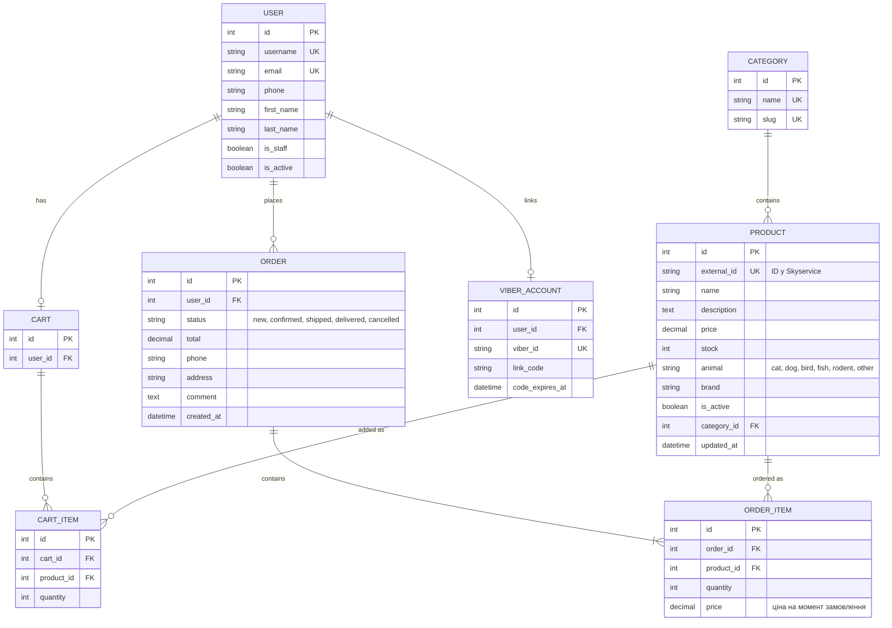

# Ly-Jess

## Команда
- Борис Петльований
- Богдан Кобзєв

## Опис
Ly-Jess — вебзастосунок інтернет-магазину товарів для домашніх тварин:
кормів, аксесуарів, іграшок і засобів догляду. Один із учасників команди
має безпосередній стосунок до реального магазину Ly-Jess, тому було
вирішено розвивати саме цю ідею.

Проєкт призначений для власників тварин, які хочуть зручно обирати й
замовляти товари онлайн, та для працівників магазину, які керують
каталогом і замовленнями.

## Ролі
- **Гість:** переглядає каталог, шукає й фільтрує товари, реєструється або входить.
- **Користувач:** додає товари в кошик, оформлює замовлення, переглядає
  історію та статуси замовлень, керує профілем, підключає Viber-бота.
- **Адміністратор:** керує каталогом і категоріями, обробляє замовлення
  та змінює їхні статуси, керує користувачами та їхніми ролями.

## Основний функціонал
- Каталог товарів із категоріями, пошуком і фільтрами
- Кошик і оформлення замовлення
- Історія та статуси замовлень
- Реєстрація й авторизація
- Адмін-панель для керування товарами, замовленнями й користувачами

## Особливість проєкту
Інтеграції:
- **Skyservice:** дані про товари беремо зі Skyservice, де вже зберігається
  вся база товарів, тому каталог не створюється з нуля.
- **Viber-бот:**
  - сповіщення про зміну статусу замовлення прямо у Viber;
  - перевірка статусу замовлення командою в чаті з ботом;
  - перегляд популярних товарів і акцій через бота;
  - підключення бота до акаунта на сайті за одноразовим кодом.

## Технології

- **Бекенд:** Python 3.12+, Django 5.2, Django REST Framework, SimpleJWT.
- **База даних:** SQLite (Django ORM).
- **Фронтенд:** HTML, CSS, JavaScript (без фреймворків), папка `frontend/`.
- **Тести:** pytest, pytest-django, pytest-cov.
- **Якість коду:** flake8, GitHub Actions (CI на кожен push і pull request).
- **Інтеграції:** Skyservice API (товари), Viber REST API (бот).

## Як запустити

```bash
git clone https://github.com/nklefdd/Ly-Jess.git
cd Ly-Jess
python -m venv .venv
```

Активація середовища — Windows PowerShell: `.\.venv\Scripts\Activate.ps1`, Linux/macOS: `source .venv/bin/activate`.

```bash
pip install -r requirements.txt
```

Скопіюйте `.env.example` у `.env` і задайте `SECRET_KEY`:

```bash
python -c "import secrets; print(secrets.token_urlsafe(64))"
```

| Змінна | Призначення | Локальне значення |
| --- | --- | --- |
| `SECRET_KEY` | Ключ Django і підпису JWT | згенерований ключ |
| `DEBUG` | Режим розробки | `True` |
| `ALLOWED_HOSTS` | Дозволені хости | `127.0.0.1,localhost` |
| `CORS_ALLOWED_ORIGINS` | Адреси фронтенду | `http://127.0.0.1:5500,http://localhost:5500` |
| `ACCESS_TOKEN_LIFETIME_MINUTES` | Строк дії access-токена | `15` |
| `REFRESH_TOKEN_LIFETIME_DAYS` | Строк дії refresh-токена | `7` |
| `LOG_LEVEL` | Рівень логування | `INFO` |

```bash
python manage.py migrate
python manage.py createsuperuser
python manage.py runserver
```

- API: http://127.0.0.1:8000/api
- Адмінпанель Django: http://127.0.0.1:8000/admin/
- Фронтенд: відкрити `frontend/index.html` через Live Server (порт 5500).

Тести:

```bash
python -m pytest
python -m pytest --cov --cov-report=term-missing
```

## Схема бази даних



### Бізнес-правила

- Email і username користувача унікальні; телефон у форматі `+380XXXXXXXXX`.
- Ціна товару більша за 0, залишок — невід’ємне ціле число.
- Категорію з товарами видалити не можна (`409`).
- У кошик не можна додати більше товару, ніж є на складі.
- Під час оформлення замовлення залишок товарів зменшується в одній транзакції; ціна фіксується в `ORDER_ITEM`.
- Статус замовлення змінюється лише вперед: `new → confirmed → shipped → delivered`; скасувати (`cancelled`) можна до відправлення, при цьому товари повертаються на склад.
- Користувач бачить лише власні замовлення.

## Ролі та права доступу

| Дія | Гість | Користувач | Адміністратор |
| --- | :---: | :---: | :---: |
| Перегляд каталогу і категорій | ✅ | ✅ | ✅ |
| Реєстрація, вхід | ✅ | — | — |
| Профіль, кошик, замовлення | — | ✅ (свої) | ✅ |
| Підключення Viber-бота | — | ✅ | ✅ |
| Керування каталогом і категоріями | — | — | ✅ |
| Зміна статусу замовлення | — | — | ✅ (скасування — і власник) |
| Керування користувачами та ролями | — | — | ✅ |
| Синхронізація товарів зі Skyservice | — | — | ✅ |

## REST API

Базова адреса: `http://127.0.0.1:8000/api`. Адреси без слеша в кінці, тіла запитів і відповідей у JSON. Для захищених запитів:

```http
Authorization: Bearer <access_token>
```

### Авторизація і користувачі

| Метод | Ендпоінт | Опис | Доступ | Успіх |
| --- | --- | --- | --- | --- |
| POST | `/auth/register` | Реєстрація | усі | `201` |
| POST | `/auth/login` | Отримати `access` і `refresh` | усі | `200` |
| POST | `/auth/refresh` | Новий `access` за `refresh` | усі | `200` |
| POST | `/auth/logout` | Додати `refresh` у чорний список | користувач | `204` |
| GET | `/auth/me` | Власний профіль | користувач | `200` |
| PATCH | `/auth/me` | Змінити ім’я, email, телефон | користувач | `200` |
| GET | `/users` | Список користувачів | адмін | `200` |
| GET | `/users/{id}` | Один користувач | адмін | `200` |
| PATCH | `/users/{id}` | Змінити роль (`user`/`admin`) або `is_active` | адмін | `200` |

Приклад реєстрації:

```json
{
  "username": "olena",
  "email": "olena@example.com",
  "phone": "+380501234567",
  "password": "River!Amber872",
  "password_confirmation": "River!Amber872"
}
```

Відповідь `201`:

```json
{
  "id": 1,
  "username": "olena",
  "first_name": "",
  "last_name": "",
  "email": "olena@example.com",
  "phone": "+380501234567",
  "role": "user"
}
```

### Каталог

| Метод | Ендпоінт | Опис | Доступ | Успіх |
| --- | --- | --- | --- | --- |
| GET | `/categories` | Список категорій | усі | `200` |
| POST | `/categories` | Створити категорію | адмін | `201` |
| GET / PUT / DELETE | `/categories/{id}` | Категорія | GET — усі, інше — адмін | `200` / `200` / `204` |
| GET | `/products` | Каталог з фільтрами і пагінацією | усі | `200` |
| POST | `/products` | Створити товар | адмін | `201` |
| GET / PUT / DELETE | `/products/{id}` | Товар | GET — усі, інше — адмін | `200` / `200` / `204` |
| POST | `/admin/sync-products` | Синхронізувати товари зі Skyservice | адмін | `200` |

Параметри `GET /products`: `category`, `animal`, `brand`, `min_price`, `max_price`, `in_stock=true`, `search` (назва та опис), `ordering` (`price`, `-price`, `name`), `page`.

### Кошик

| Метод | Ендпоінт | Опис | Успіх |
| --- | --- | --- | --- |
| GET | `/cart` | Вміст кошика і загальна сума | `200` |
| POST | `/cart/items` | Додати товар `{"product": 1, "quantity": 2}` | `201` |
| PATCH | `/cart/items/{id}` | Змінити кількість | `200` |
| DELETE | `/cart/items/{id}` | Прибрати товар | `204` |
| DELETE | `/cart` | Очистити кошик | `204` |

Доступ — лише авторизований користувач, тільки до власного кошика.

### Замовлення

| Метод | Ендпоінт | Опис | Доступ | Успіх |
| --- | --- | --- | --- | --- |
| GET | `/orders` | Свої замовлення (адмін — усі, фільтр `?status=`) | користувач | `200` |
| POST | `/orders` | Оформити замовлення з кошика `{"phone", "address", "comment"}` | користувач | `201` |
| GET | `/orders/{id}` | Деталі замовлення | власник або адмін | `200` |
| PATCH | `/orders/{id}/status` | Змінити статус `{"status": "shipped"}` | адмін; `cancelled` — і власник | `200` |

### Viber-бот

| Метод | Ендпоінт | Опис | Доступ | Успіх |
| --- | --- | --- | --- | --- |
| POST | `/viber/link-code` | Отримати одноразовий код (діє 10 хв) | користувач | `201` |
| DELETE | `/viber/link` | Відв’язати Viber | користувач | `204` |
| POST | `/viber/webhook` | Події від Viber (перевірка підпису) | Viber | `200` |

Команди бота: `код <XXXXXX>` — прив’язати акаунт, `статус <номер>` — статус замовлення, `популярне` — популярні товари, `акції` — товари зі знижкою. Після зміни статусу замовлення користувач отримує повідомлення у Viber.

## Обробка помилок

Усі помилки повертаються в одному форматі:

```json
{
  "error": {
    "status": 400,
    "message": "Некоректні дані. Перевірте поля запиту.",
    "details": {
      "phone": ["Телефон має бути у форматі +380XXXXXXXXX."]
    }
  }
}
```

| Статус | Значення |
| --- | --- |
| `400` | Невалідні дані (поле `details` містить помилки полів) |
| `401` | Немає токена, токен недійсний або прострочений |
| `403` | Недостатньо прав |
| `404` | Об’єкт не знайдено |
| `409` | Дія суперечить стану даних (категорія з товарами, недостатньо товару на складі) |
| `502` | Зовнішній сервіс (Skyservice, Viber) недоступний |

## Робота в команді

- Гілка `main` захищена: зміни потрапляють туди лише через pull request з одним approve.
- Одна задача — одна гілка: `feature/...`, `fix/...`, `docs/...`, `test/...`.
- Кожен PR ревьюїть інший учасник команди; CI має бути зеленим перед merge.
